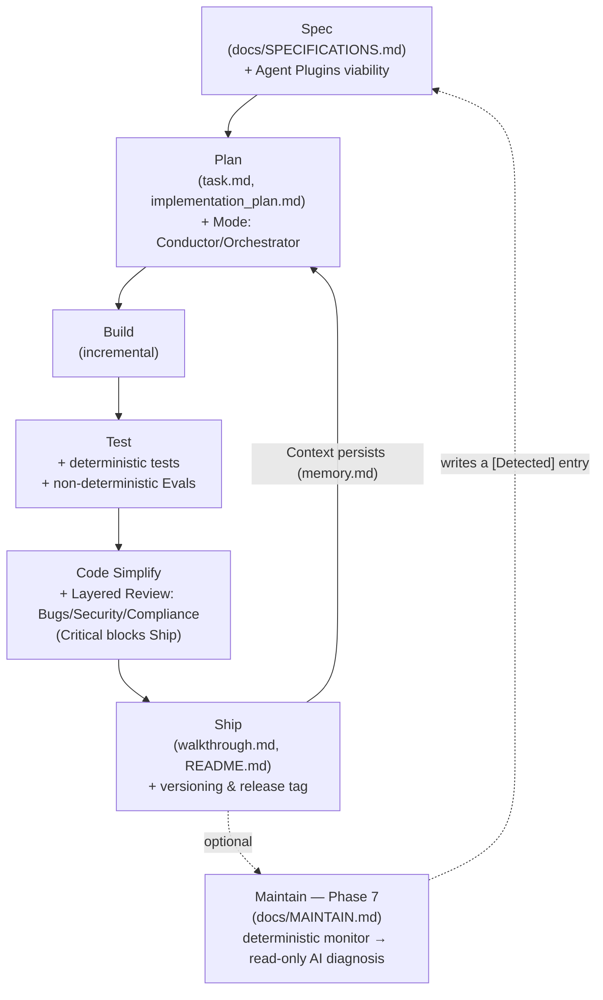

# ⚡ dbv-specs-ops

> *The blueprint that turns any AI assistant into a disciplined Senior Engineer.*

<p align="right">🇬🇧 English · <a href="./README.md">🇪🇸 Leer en español</a></p>


---

**dbv-specs-ops** is a lightweight engineering system designed to maximize software quality and context persistence in AI-assisted development.

This repository acts as a **master blueprint** that transforms your AI assistant from a simple code generator into a Senior Software Engineer that follows rigorous processes.

---

<a name="start"></a>
## 🚀 Get Started in a Minute

Open your AI assistant (Claude Code, Codex, Gemini CLI, Copilot, Cursor, Windsurf…) in the folder where you want your project and write:

> **I want to create a project using the dbv-specs-ops framework you can find at github.com/davidbuenov**

The AI downloads the framework into the `dbv-specs-ops/` subfolder, sets up your assistant's activation files and proposes the initial configuration (name, license, stack…) for you to confirm in one go. After that you work in phases: `/spec`, `/plan`, `/build`, `/test`, `/code-simplify` and `/ship`.

| I want to… | Tell the AI |
|---|---|
| **Create a new project** | *I want to create a project using the dbv-specs-ops framework you can find at github.com/davidbuenov* |
| **Add it to a project that already has code** | *I want to adopt the dbv-specs-ops framework (github.com/davidbuenov/dbv-specs-ops) in this existing project* |
| **Upgrade a project that already uses it** | Save [`UPGRADE_PROMPT.md`](https://raw.githubusercontent.com/davidbuenov/dbv-specs-ops/master/docs/UPGRADE_PROMPT.md) as `dbv-specs-ops/docs/UPGRADE_PROMPT.md` and write: *Read dbv-specs-ops/docs/UPGRADE_PROMPT.md and upgrade my project* ([details](#upgrade)) |

Prefer to do it yourself? See the [manual installation](#manual).

<details>
<summary>🤖 <b>Instructions for the AI</b> (if a user asked you to use this framework)</summary>

1. **Install the framework in the project's `dbv-specs-ops/` subfolder**, without git history (so there is nothing to delete): create the folder, download the archive and extract it stripping the top-level directory.

   ```bash
   mkdir dbv-specs-ops
   curl -L -o dbv-specs-ops.tar.gz https://github.com/davidbuenov/dbv-specs-ops/archive/refs/heads/master.tar.gz
   tar -xzf dbv-specs-ops.tar.gz --strip-components=1 -C dbv-specs-ops
   rm dbv-specs-ops.tar.gz
   ```

   It works the same on macOS, Linux and Windows 10+ (in PowerShell use `curl.exe`). **Do not use `git clone`** unless you cannot download the archive: it would leave a nested `.git` that would have to be deleted. If `dbv-specs-ops/` already exists, the project already uses the framework: offer to upgrade it with `dbv-specs-ops/docs/UPGRADE_PROMPT.md` instead of reinstalling.
2. **Create the activation files in the project root** that redirect to that subfolder. At least `CLAUDE.md` and `AGENTS.md`, with this content (if they already exist with the user's own content, add these lines at the top and delete nothing):

   ```markdown
   Please read and follow the master instructions in dbv-specs-ops/docs/MASTER_PROMPT.md. All specs, tasks, and memory logs are located inside the dbv-specs-ops/ folder.
   ```

   If the user works with Claude Code, also copy `dbv-specs-ops/.claude/commands/` to `.claude/commands/` in the root; if your environment protects the `.claude/` folder and you cannot write there, do not insist: ask the user to copy it. The Bootstrap will complete the remaining activation files.
3. **Read `dbv-specs-ops/docs/MASTER_PROMPT.md` and follow its workflow.** The Bootstrap has you propose the initial configuration for the user to confirm in a single message. If the project already has code, follow `dbv-specs-ops/docs/ADOPTION_PROMPT.md`.
4. Do not run `git init` or delete/reset any file without the user's explicit confirmation.

</details>

---

## 📑 Table of Contents

- [Get Started in a Minute](#start)
- [Key Features](#features)
- [How It Differs from Other SDD Frameworks](#comparison)
- [Origin & Inspiration](#origin)
- [Visual Workflow](#workflow)
- [The 6 Development Phases](#phases)
- [File Structure](#structure)
- [Platform Activation](#platforms)
- [Manual Installation](#manual)
- [Adopting an Existing Project](#adoption)
- [Upgrading an Existing Project](#upgrade)
- [Example Usage](#example)
- [FAQ](#faq)
- [Contributing](#contributing)
- [Status](#status)
- [Authors & Credits](#credits)
- [Inspiration & References](#references)

---

<a name="features"></a>
## ✨ Key Features

*   **Spec-Driven Development (SDD) Lifecycle**: A strict 6-phase flow (*Spec → Plan → Build → Test → Simplify → Ship*) that ensures your AI assistant understands the "why" and "what" before writing a single line of code.
*   **Context & Token Economics**: Leverages structured persistence files (`memory.md` for qualitative design decisions and `task.md` for task logs) to eliminate AI amnesia and optimize token consumption in large projects.
*   **Dual Coding Modes**: The AI self-classifies tasks as *Conductor Mode* (quick, interactive IDE edits) or *Orchestrator Mode* (autonomous, background tasks using asynchronous commands).
*   **Unified Validation (Tests & Evals)**: Combines classical deterministic testing with non-deterministic AI Evals (LLM Judges, formatting checks, and hallucination scans) in the `/test` phase.
*   **Security Review Gate**: A mandatory `/code-simplify` phase that automatically audits code for credential leaks, dependency squatting (*slopsquatting*), and input sanitization.
*   **Declarative Agent Harness**: Configures how the AI interacts with local sandbox environments and resources via the universal **Agent Plugins 1.0.0** standard.
*   **Native Agent Readiness (Web/APIs)**: If enabled, it automatically bootstraps the standard files, headers, and directories (`robots.txt` with Content-Signals, `llms.txt`, `auth.md`, catalogs under `.well-known/` and a unified **Agent Plugin** directory containing `plugin.json` and `mcp.json` specs) to make your web project perfectly readable and discoverable for external AI agents.
*   **Zero-Collision Upgrades**: A dedicated upgrade prompt agent that automatically migrates your project's framework files without touching your source code or custom specs.
*   **Design Enrichment & Audits (Optional)**: Seamlessly integrates community visual design tools (**[Impeccable](https://github.com/pbakaus/impeccable)** for dual-agent accessibility/contrast audits and Nielsen heuristics, and **[SkillUI](https://github.com/amaancoderx/npxskillui)** for extraction/reverse engineering of design tokens from reference URLs).
*   **Layered Code Review with Severities (`docs/REVIEW.md`)**: `/code-simplify` runs three explicit passes (Bugs, Security, Compliance — including this prompt's own `<coding_standards>`) tagged Critical / Important / Nit — Critical findings block `/ship`.
*   **Deterministic Guardrails (Optional, `docs/GUARDRAILS.md`)**: Distinguishes *advisory* instructions (this prompt) from git/CI-level guardrails (pre-commit hooks, branch protection) that hold even if the model forgets a rule.
*   **Formalized Parallel Work (`docs/PARALLEL_WORK.md`)**: Concrete `git worktree` mechanics for running 2-3 independent AI sessions in parallel, plus a portable pattern for scoped read-only subtasks.
*   **Optional Maintain Phase — Loop Closure (`docs/MAINTAIN.md`)**: A deterministic monitor can trigger a read-only AI diagnosis that writes a new `[Detected]` entry into `SPECIFICATIONS.md`, re-entering the cycle at `/plan` — disabled by default, never deploys or merges on its own.
*   **Native Claude Code Commands (`.claude/commands/`)**: `/spec /plan /build /test /code-simplify /ship /maintain` ship as real slash commands with autocomplete, not just chat text.
*   **Open `AGENTS.md` Standard Compatible**: A thin `AGENTS.md` pointer (read by Codex, Cursor, Copilot, Windsurf, Jules, Zed and others) carries the same rules as `CLAUDE.md` and `GEMINI.md` without duplicating content: everything lives in `MASTER_PROMPT.md`.
*   **Spec-to-Test Traceability (`REQ-NN` ↔ `@spec`)**: Every new requirement gets a unique ID in `SPECIFICATIONS.md`; code and tests cite it with `@spec REQ-NN`, and the linter reports requirements that are untagged, untested or duplicated. It is optional and backward-compatible: requirements without an ID in earlier projects keep working unchanged.
*   **Deterministic Linter (`scripts/dbv-lint.py`)**: Python standard library only (3.8+). It checks the single-`return` rule with Guard Clauses through the AST, the `implementation_plan.md` Frontmatter and traceability. With `--changed` or `--staged` (pre-commit) it only looks at what you touch, so a legacy codebase is not flooded with warnings.
*   **Adversarial Review with Evidence and Confidence**: The `<builder>` vs `<adversary>` debate in `/plan` must cite its source (`<evidence>`) and self-assess confidence on three axes (`<confidence_score>`: edge cases, security, concurrency). A `low` axis forces a stop and a request for validation.
*   **Hot/Warm/Cold Context Compression**: A protocol that keeps `memory.md` from degrading the AI's attention in long-lived projects (recent ADRs in full, older ones in one line, history in `memory.archive.md`).
*   **Subagent Contracts (Scope Lock)**: Each parallel session declares which files it may touch and which requirement-ID range it reserves, to avoid collisions between branches (`docs/PARALLEL_WORK.md`).
*   **Native Desktop (Tauri v2) & Hybrid AI**: Production guides for desktop apps and a three-tier AI engine (local models, cloud with the key in the OS-native keyring, subscription agents via ACP), with Rust-specific standards (`Result` in IPC commands, no `.unwrap()` at runtime) and bundler-less frontend standards (IIFE).
*   **Phase Graph (`docs/PROCEDURAL_GRAPH.json`)**: The cycle is described as transitions with a `condition` (the gate to move on), `guidance` (how to run the phase) and `pitfalls` (what to avoid), including the way back (Plan → Spec, Test → Build, Simplify → Build). Each phase command receives only its 2-hop neighborhood, generated with `scripts/pg-guide.py`, and the linter fails if a command drifts from the graph. Inspired by *[Procedural Graphs](https://arxiv.org/abs/2609.09153)* (Google).
*   **Rejection Memory**: A section of `memory.md` that records approaches that were tried and discarded (an architecture rejected in the Architect Review, a reverted fix or refactor). The AI checks it before proposing, so no session repeats a path that already failed.

---

<a name="comparison"></a>
## 🆚 How Does It Differ from GitHub Spec Kit, BMAD or Kiro?

Other SDD frameworks such as [Spec Kit](https://github.com/github/spec-kit), [BMAD](https://github.com/bmad-code-org/BMAD-METHOD) or [Kiro](https://kiro.dev/) cover the specify → plan → implement flow very well. **dbv-specs-ops** shares that flow and adds the rest of the engineering and product delivery lifecycle, backed by deterministic checks:

| Capability | **dbv-specs-ops (v3.1)** | [**GitHub Spec Kit**](https://github.com/github/spec-kit) | [**BMAD Method**](https://github.com/bmad-code-org/BMAD-METHOD) | [**Kiro (AWS)**](https://kiro.dev/) |
| :--- | :---: | :---: | :---: | :---: |
| **Specify and plan before coding** | ✅ | ✅ | ✅ | ✅ |
| **Specs as project files** | ✅ | ✅ | ✅ | ✅ |
| **Persistent project rules for the AI** | ✅ | ✅ | ✅ | ✅ |
| **One-sentence start (no CLI to install)** | ✅ | ❌ | ❌ | ⚠️ Web version |
| **Automatic author headers in code** | ✅ | ❌ | ❌ | ❌ |
| **Requirement → code and tests traceability (`@spec`)** | ✅ | ⚠️ | ⚠️ | ⚠️ |
| **Own deterministic linter (0 deps)** | ✅ | ❌ | ❌ | ❌ |
| **Sites ready for GEO and Agents (`llms.txt`, MCP)** | ✅ | ➖ | ➖ | ➖ |
| **Desktop apps (Win/Mac/Linux) + MS Store / Brew** | ✅ | ➖ | ➖ | ➖ |
| **AI-Native architecture (Local, Cloud, ACP/MCP)** | ✅ | ➖ | ➖ | ➖ |
| **Auto-generated cross-platform `start` / `stop` scripts** | ✅ | ➖ | ➖ | ➖ |
| **Git, Changelog and `/ship` management** | ✅ | ⚠️ Partial | ⚠️ Partial | ⚠️ Partial |
| **Adversarial review of plans and code** | ✅ | ⚠️ Quality gates | ⚠️ Adversarial lenses | ⚠️ Upfront analysis |
| **Phase gates injected into each command (phase graph)** | ✅ | ⚠️ Optional quality gates | ⚠️ Gates inside some skills | ⚠️ Approval between phases |
| **Memory of discarded approaches** | ✅ | ❌ | ⚠️ Observed pitfalls | ❌ |
| **Community and maturity (GitHub ⭐, 2026-10-15)** | ❌ 29 ⭐ | ✅ 141 k ⭐ | ✅ 54 k ⭐ | ➖ AWS product |
| **Ecosystem and extensibility** | ⚠️ | ✅ | ✅ | ✅ |
| **Integrated IDE / visual interface** | ❌ | ❌ | ❌ | ✅ |

✅ Yes · ⚠️ Partial or a different approach · ❌ Not stated in its official documentation · ➖ Out of scope. Checked against the official sites of [Spec Kit](https://github.com/github/spec-kit), [BMAD](https://github.com/bmad-code-org/BMAD-METHOD) and [Kiro](https://kiro.dev/) on 2026-10-15 (the phase-graph and discarded-approaches rows, on 2026-10-16). And yes: by stars, **dbv-specs-ops is the last of the three open-source projects**. The full comparison also spells out its limitations.

👉 **[See the full, detailed technical comparison in `docs/COMPARISON.en.md`](docs/COMPARISON.en.md)**

---

<a name="origin"></a>
## 📑 Origin & Inspiration

This workflow is a unified, simplified version of industry pillars, adapted to be lightweight and highly effective:

1. **[Agent Skills (Google/Addy Osmani)](https://github.com/addyosmani/agent-skills):** The **process and technical workflow** (Cycle: Spec → Plan → Build → Test → Simplify → Ship).
2. **[GitHub Spec-Kit](https://github.com/github/spec-kit):** The **quality of specification**, focusing on understanding the problem, risks, and open questions before coding.
3. **[AI Coding Best Practices](https://github.com/davidbuenov/ai-coding-best-practices):** The final layer of **style and excellence** that dictates how the final code should be written.
4. **[design.md (Google Labs)](https://github.com/google-labs-code/design.md):** The **visual design system standard** — a format for describing a visual identity to coding agents, now integrated as `docs/DESIGN.md`.
5. **[The New SDLC With Vibe Coding (Google/Addy Osmani et al.)](https://www.kaggle.com/whitepaper-the-new-SDLC-with-vibe-coding):** The theoretical foundation for **Agentic Engineering** (transitioning from prompting to a controlled codebase factory model, Evals, and Harness engineering).
6. **[Agent Plugins](https://agent-plugins.org/specification):** The **vendor-neutral standard** (by Google, Amazon, Microsoft, OpenAI, Vercel) for packaging Agent Skills and MCP servers into a portable unit, integrated under `docs/AGENT_PLUGINS.md`.
7. **[The AI-Native SDLC Playbook (Anthropic)](https://claude.com/blog/the-ai-native-sdlc-playbook):** The blueprint for **closing the loop** — adapted, vendor-agnostically, as the optional Maintain phase (`docs/MAINTAIN.md`), layered code review with severities (`docs/REVIEW.md`), deterministic guardrails (`docs/GUARDRAILS.md`), and formalized parallel worktree sessions (`docs/PARALLEL_WORK.md`).
8. **[Procedural Graphs: Self-Evolving Execution Structures for LLM Agents (Google, Lu et al., 2026)](https://arxiv.org/abs/2609.09153):** **Procedural memory** as a graph: the phase cycle as transitions with `condition`, `guidance` and `pitfalls` (`docs/PROCEDURAL_GRAPH.json`), a local 2-hop context per phase instead of every rule at once, and the **Rejection Memory** in `memory.md`. Adapted, not copied: what was taken and what was not, in [`docs/PROCEDURAL_GRAPHS.md`](./docs/PROCEDURAL_GRAPHS.md).

---

<a name="workflow"></a>
## 🗺️ Visual Workflow



---

<a name="phases"></a>
## ⚩️ The 6 Development Phases

Each phase has a **trigger command** you can type in the chat at any time. The AI will always respect this order — never skipping a phase without your approval. A bare command (just `/build`, with no extra text) is enough: the AI treats it as "run this phase now," cascading through any missing prior phase instead of rejecting it.

| # | Phase | Command | What the AI does | What you do | Output |
|---|---|---|---|---|---|
| 1 | **Spec** | `/spec` | Reviews if the requirement is defined in `SPECIFICATIONS.md`. If not, asks clarifying questions before acting. Gives every new requirement an ID (`REQ-NN`). | Describe the feature or change you need. | Updated `SPECIFICATIONS.md` |
| 2 | **Plan** | `/plan` | **Architect Review:** Validates specs for edge cases first. If valid, breaks the work into atomic steps. For complex tasks, creates `implementation_plan.md` and waits for explicit approval. | Review and approve the plan. | `task.md` + `implementation_plan.md` |
| 3 | **Build** | `/build` | Implements logic incrementally. Adds file headers, sets up the virtual environment for Python (with `uv` when available), tags code that implements a requirement with `@spec REQ-NN`, generates startup scripts for servers and APIs, updates `CHANGELOG.md [Unreleased]`. | Sit back. Review the code if you wish. | Source code + `CHANGELOG.md` updated |
| 4 | **Test** | `/test` | Creates and runs unit or integration tests, citing in each one the requirement it validates (`@spec REQ-NN`). A task is **not marked as done** without a passing test. Fixes found bugs and logs them in `CHANGELOG.md`. | Run the tests if you want to confirm locally. | Test files + `CHANGELOG.md` updated |
| 5 | **Simplify** | `/code-simplify` | Runs the layered review (`docs/REVIEW.md`: Bugs / Security / Compliance) then refactors for clarity. No new features — only polish and Critical fixes. "Clarity over cleverness." | Optional: review and validate the refactor. | Cleaner, simpler code |
| 6 | **Ship** | `/ship` | Blocks if Critical review findings remain. Updates `README.md`, completes `walkthrough.md`, asks for version type (Patch / Minor / Major), publishes `CHANGELOG.md`, proposes git commit + tag. | Choose the version type and confirm. | Versioned release 🚀 |

> **Tip:** You can jump to any phase by command. For example, type `/ship` when you're ready to deliver and the AI will handle versioning, changelog and git automatically.

> **Optional Phase 7 — Maintain (`/maintain`):** Closes the loop without a human trigger. A deterministic
> monitor (CI/cron watching a metric) can invoke the AI read-only to diagnose a deviation and write it as a
> new `[Detected]` entry in `SPECIFICATIONS.md`, which then re-enters the cycle at `/plan` like any other
> requirement. Disabled by default — enable it in `project.config.md`. See [`docs/MAINTAIN.md`](./docs/MAINTAIN.md).

---

<a name="structure"></a>
## 📂 File Structure

All control files of the framework reside inside the `dbv-specs-ops/` folder:

#### `/dbv-specs-ops/docs` folder:
| File | Purpose |
|---|---|
| [`MASTER_PROMPT.md`](./docs/MASTER_PROMPT.md) | The brain of the system. Rules, workflow and constraints the AI must follow. |
| [`SPECIFICATIONS.md`](./docs/SPECIFICATIONS.md) | The "What" and "Why". Problem, objectives and acceptance criteria. |
| [`ARCHITECTURE.md`](./docs/ARCHITECTURE.md) | The "How". Tech stack, design decisions and system structure. |
| [`DESIGN.md`](./docs/DESIGN.md) | The "Look". Visual design system: color tokens, typography, spacing and UI components. *(Optional for projects without UI)* |
| [`DESIGN_ENRICHMENT.md`](./docs/DESIGN_ENRICHMENT.md) | Optional guide for visual audits and reverse-engineering design tokens (Impeccable & SkillUI). |
| [`WEB_TO_DESKTOP_MIGRATION.md`](./docs/WEB_TO_DESKTOP_MIGRATION.md) | Strategic decisions for turning an existing web app into a native desktop app. Read **before** `NATIVE_DESKTOP_APPS.md`. *(Only when the code already exists as a web app)* |
| [`NATIVE_DESKTOP_APPS.md`](./docs/NATIVE_DESKTOP_APPS.md) | Desktop app architecture (Tauri v2) & 8 design lessons. *(Optional for web projects)* |
| [`AI_DESKTOP_ARCHITECTURE.md`](./docs/AI_DESKTOP_ARCHITECTURE.md) | Hybrid AI assistant integration (Local, Cloud & ACP Agents with subscription). Secure OS keyring secrets. |
| [`NATIVE_APPS_RELEASE_CI.md`](./docs/NATIVE_APPS_RELEASE_CI.md) | Cross-platform GitHub Actions CI/CD for native desktop binaries. *(Optional for web projects)* |
| [`MARKETPLACE_PUBLISHING.md`](./docs/MARKETPLACE_PUBLISHING.md) | App marketplace submission guide & checklist (Microsoft Store, Uptodown, etc.). *(Optional for web projects)* |
| [`templates/`](./docs/templates/) | AI specification templates (`AI_SPECIFICATIONS.template.md`), bilingual user guide templates (`IA.template.md`, `IA.en.template.md`) and clean `task.md` / `memory.md` templates (`task.template.md`, `memory.template.md`). |
| [`REVIEW.md`](./docs/REVIEW.md) | Review passes and severities (Bugs / Security / Compliance, including `<coding_standards>`) used by `/code-simplify`. |
| [`GUARDRAILS.md`](./docs/GUARDRAILS.md) | Deterministic guardrails (git/CI) that back up advisory prompt rules. *(Optional)* |
| [`PARALLEL_WORK.md`](./docs/PARALLEL_WORK.md) | `git worktree` mechanics for running independent AI sessions in parallel (Orchestrator Mode). |
| [`SOURCE_OF_TRUTH.md`](./docs/SOURCE_OF_TRUTH.md) | How to coexist with an external system (Jira, ServiceNow, etc.). *(Optional)* |
| [`METRICS.md`](./docs/METRICS.md) | Leading/lagging indicators per phase, readable from git history alone. *(Optional)* |
| [`MAINTAIN.md`](./docs/MAINTAIN.md) | Optional Phase 7 — autonomous loop closure. See callout above. |
| [`PROCEDURAL_GRAPH.json`](./docs/PROCEDURAL_GRAPH.json) | The phase cycle as transitions with `condition` / `guidance` / `pitfalls`. Single source of the blocks in `.claude/commands/`. |
| [`PROCEDURAL_GRAPHS.md`](./docs/PROCEDURAL_GRAPHS.md) | Guide to the phase graph and the Rejection Memory: what was taken from *Procedural Graphs* and what was not, and how to change the graph safely. *(In Spanish)* |

#### `/dbv-specs-ops/` (Framework Root):
| File | Purpose |
|---|---|
| [`project.config.md`](./project.config.md) | Project identity: name, author, license and file header template. Filled by the AI during the bootstrap interview. |
| [`CHANGELOG.md`](./CHANGELOG.md) | Version history. The AI updates the `[Unreleased]` section during `/build` and `/test`, and publishes it on each `/ship`. |
| [`task.md`](./task.md) | The logbook. Quantitative progress (checklist), backlog, and **Context Snapshots**. |
| [`evals/`](./evals/) + [`scripts/run-evals.sh`](./scripts/run-evals.sh) | *(Optional)* Regression suite for the agent's own configuration (`MASTER_PROMPT.md` and activation files) — not for your project's code. See `evals/README.md`. |
| [`scripts/dbv-lint.py`](./scripts/dbv-lint.py) | Deterministic linter (Python 3.8+, no dependencies): single-`return` rule through the AST, plan Frontmatter, `@spec` traceability and the phase graph. `python dbv-specs-ops/scripts/dbv-lint.py --help`. |
| [`scripts/pg-guide.py`](./scripts/pg-guide.py) | Phase graph (Python 3.8+, no dependencies): validates its structure, prints a phase's context (`--node build`) and regenerates the command blocks (`--write-commands`). |
| [`memory.md`](./memory.md) | **Context and Decisions.** Qualitative knowledge: active context, technical decisions (ADRs), lessons learned, **Rejection Memory** (discarded approaches) and relations map. AI must consult it at session start. |
| `implementation_plan.md` | Created at the `/plan` phase. Detailed technical plan for the AI to fill in and get approved before building. |
| `walkthrough.md` | Created at the `/ship` phase. Summary of what was built, tested and delivered. |

#### Framework root (this repo):
| File | Purpose |
|---|---|
| [`.claude/commands/`](./.claude/commands/) | *(Optional, Claude Code only)* Native slash commands for each phase (`/spec` … `/maintain`) with autocomplete; each one carries its phase context, generated from the graph. |

---

<a name="platforms"></a>
## 🤖 Platform Activation

Each AI assistant loads context differently. Use the corresponding file:

| Platform | Activation file | Loading |
|---|---|---|
| **Claude Code** (CLI / VS Code / Desktop) | `CLAUDE.md` | Automatic at session start |
| **GitHub Copilot** (VS Code / JetBrains) | `.github/copilot-instructions.md` | Automatic in the workspace |
| **Cursor** | `AGENTS.md` (or `CLAUDE.md`, compatible) | Automatic |
| **Antigravity** (VS Code · by Google DeepMind) | `GEMINI.md` (auto) + `ANTIGRAVITY.md` (docs & extra setup) | Automatic (+ optional manual KI setup) |
| **Windsurf** | `.windsurfrules` (or `AGENTS.md`) | Automatic |
| **OpenAI Codex, Jules, Zed, Aider, JetBrains Junie and other agents** ([AGENTS.md open standard](https://agents.md)) | `AGENTS.md` | Automatic |
| **ChatGPT / Gemini Web** | `docs/MASTER_PROMPT.md` | Manual: attach or paste in the first message |
| **Gemini CLI** | `GEMINI.md` | Automatic |

> **About `AGENTS.md`:** it is an open standard stewarded by the Agentic AI Foundation (Linux Foundation). This framework ships it as a thin pointer carrying the same rules as `CLAUDE.md` and `GEMINI.md`. Claude Code (≥ 2.1.277) only reads `AGENTS.md` when no `CLAUDE.md` exists, so with both files nothing is loaded twice. Gemini CLI only reads it if you add `"AGENTS.md"` to `context.fileName` in its `settings.json`; by default it uses `GEMINI.md`.

---

<a name="manual"></a><a name="quickstart"></a>
## 🛠️ Manual Installation (Subfolder Isolation)

> These are the steps the AI follows for you in [Get Started in a Minute](#start). Use them if you prefer to install it by hand.

This framework is designed to live in a dedicated subdirectory (`dbv-specs-ops/`) inside your project's workspace. This keeps your root folder clean, avoids overwriting project files, and keeps SDD metadata isolated.

#### Step 1 — Copy the Framework Folder
Create a folder named `dbv-specs-ops` in the root of your project, and copy all the files from this repository into it.

#### Step 2 — Place the Activation Files in the Root
Since AI assistants only load configuration files from the workspace root directory, you **must copy or create** the appropriate activation file(s) in the root of your project to redirect the AI:

*   **For Claude Code / Cursor (`CLAUDE.md` in root):**
    ```markdown
    Please read and follow the master instructions in dbv-specs-ops/docs/MASTER_PROMPT.md. All specs, tasks, and memory logs are located inside the dbv-specs-ops/ folder.
    ```
    Claude Code users: also copy the [`.claude/commands/`](./.claude/commands/) folder from this repo into
    your project root to get `/spec`, `/plan`, `/build`, `/test`, `/code-simplify`, `/ship` and `/maintain`
    as real native slash commands (with autocomplete) instead of plain chat text.
*   **For GitHub Copilot (`.github/copilot-instructions.md` in root):**
    ```markdown
    This project uses Spec-Driven Development (SDD). Rules, specifications and tasks live in the `dbv-specs-ops/` subdirectory.
    Read and strictly follow `dbv-specs-ops/docs/MASTER_PROMPT.md`.
    ```
*   **For Windsurf (`.windsurfrules` in root):**
    ```json
    {
      "rules": [
        "Please read and follow the master instructions in dbv-specs-ops/docs/MASTER_PROMPT.md. All specs, tasks, and memory logs are located inside the dbv-specs-ops/ folder."
      ]
    }
    ```
*   **For Gemini CLI / Antigravity (`GEMINI.md` in root):**
    ```markdown
    Please follow the SDD rules and files located in `dbv-specs-ops/`.
    Master prompt is at `dbv-specs-ops/docs/MASTER_PROMPT.md`.
    ```
*   **For Codex, Cursor, Jules, Zed, Aider and other compatible agents (`AGENTS.md` in root).** If you already have your own `AGENTS.md`, add these lines at the top instead of overwriting it:
    ```markdown
    # AGENTS.md
    Please follow the SDD rules and files located in `dbv-specs-ops/`.
    Master prompt is at `dbv-specs-ops/docs/MASTER_PROMPT.md`.
    ```

#### Step 3 — Kick off the session
Simply write `/spec` (or paste `dbv-specs-ops/docs/MASTER_PROMPT.md` if using a manual interface like ChatGPT web). The AI will start the Engineering Interview to define the application requirements, filling out `dbv-specs-ops/docs/SPECIFICATIONS.md`.

---

<a name="adoption"></a>
## 🔍 Adopting an Existing Project

If your project already has code, install the framework (with the message from [Get Started in a Minute](#start) or the [manual installation](#manual)) and write to your AI assistant:

> "Adapt this project to the SDD methodology using the framework configuration inside the `dbv-specs-ops` folder. Refer to `dbv-specs-ops/docs/ADOPTION_PROMPT.md` for instructions."

The AI will analyze your existing files and run the interview to populate the SDD files under `dbv-specs-ops/`.

---

<a name="upgrade"></a>
## ⬆️ Upgrading an Existing Project

Already using dbv-specs-ops and want to get the latest features? You only need **one file**.

#### Step 1 — Download `UPGRADE_PROMPT.md`

> **[⬇️ Download UPGRADE_PROMPT.md](https://raw.githubusercontent.com/davidbuenov/dbv-specs-ops/master/docs/UPGRADE_PROMPT.md)**
>
> Right-click → Save As → save it as `dbv-specs-ops/docs/UPGRADE_PROMPT.md` inside your project.

#### Step 2 — Tell your AI

```
Read dbv-specs-ops/docs/UPGRADE_PROMPT.md and upgrade my project.
```

That's it. The AI detects your current version, calculates what needs updating, and applies only the framework files.

#### What the AI will do
- ✅ Detect your current framework version (reads `dbv-specs-ops/project.config.md` or asks you)
- ✅ Download and update only the framework files that changed since your version
- ✅ Add new optional files if missing (e.g. `dbv-specs-ops/docs/DESIGN.md` for UI projects)
- ✅ Show you a full summary of every change applied

> **Upgrading to v3.1.0 breaks nothing you already have.** Your specifications, backlog, `memory.md` and code are not touched. Requirements without an ID keep working, and `REQ-NN` IDs are only required for what you write from now on. The AI adds the *Rejection Memory* section to your `memory.md` the first time it has something to record.

#### What the AI will NEVER touch

| File | Why it's protected |
|---|---|
| `dbv-specs-ops/docs/SPECIFICATIONS.md` | Your project requirements |
| `dbv-specs-ops/docs/ARCHITECTURE.md` | Your technical decisions |
| `dbv-specs-ops/task.md` and `dbv-specs-ops/memory.md` | Your backlog, state and decisions |
| `dbv-specs-ops/CHANGELOG.md` | Your version history |
| `README.md` | Your project documentation |
| All source code | Your application |

---

<a name="example"></a>
## 🧑‍💻 Example Usage

**1. Phase 1: Specification**

`docs/SPECIFICATIONS.md`:
```markdown
- Problem: "Users forget important tasks."
- Objective: "Build a cross-platform reminder system."
- Feature A: "The user can create, edit and delete reminders."
```

**2. Plan:**

`task.md`:
```markdown
- [ ] Implement the Reminder model
- [ ] Build the REST API for reminders
- [ ] Add unit tests for Reminder
```

**3. Build / Test / Ship:**

The cycle continues until the result is delivered and documented in `walkthrough.md`.

---

<a name="faq"></a>
## ❓ FAQ

**Can I use this template with any AI assistant?**
Yes, it includes activation files for Claude, Copilot, Gemini, Antigravity, Windsurf and ChatGPT.

**What if I already have code?**
Follow the "Adopting an Existing Project" section and use `docs/ADOPTION_PROMPT.md`.

**What if the AI doesn't follow the cycle?**
Make sure it has read `docs/MASTER_PROMPT.md` and that the context is up to date in `task.md`.

**Why does Test come before Simplify?**
Tests are the safety net a refactor is checked against. Passing tests first means any failure after `/code-simplify` unambiguously came from the refactor, not from a pre-existing bug — "make it work, then make it right."

**How do I contribute?**
Fork, create a descriptive branch, and open a Pull Request. See the Contributing section below.

---

<a name="contributing"></a>
## 🤝 Contributing

1. Fork the repository and create a descriptive branch.
2. Make your changes following the cycle: Spec → Plan → Build → Test → Simplify → Ship.
3. Open a Pull Request explaining the reason and the impact.
4. If it's a methodology improvement, add examples and update the documentation.

---

<a name="status"></a>
## 🛠 Status

* **Version:** 3.1.0
* **Methodology:** Spec-Driven Development (SDD)
* **Goal:** Universal AI-assisted development template for any platform and assistant.

---

<a name="credits"></a>
## ✍️ Authors & Credits

### 👤 Conceived and directed by

#### David Bueno Vallejo

> "Original idea, methodology vision, document system design, testing and refinement."

[](https://www.linkedin.com/in/davidbueno/)
[](https://davidbuenov.com)

---

### 📖 Key Reference Book
* **[The New SDLC With Vibe Coding](https://www.kaggle.com/whitepaper-the-new-SDLC-with-vibe-coding)** — Whitepaper by Addy Osmani, Shubham Saboo and Sokratis Kartakis (Google, May 2026), used as the theoretical foundation for the Agentic Harness, Evals, and the Factory model in v2.0.0.

---

### 🤖 Built with AI Pair Programming

| Tool | Role |
|---|---|
| **[Claude Code](https://claude.ai/code)** · *Anthropic* | Main agent: document structure design, prompt engineering, platform files, methodology refinement. |
| **[Antigravity](https://antigravity.google)** · *Google DeepMind* | Antigravity-specific integration, planning artifacts design, compatibility testing. |
| **[Gemini](https://gemini.google.com)** · *Google* | Methodology validation and adoption flow testing on existing projects. |
| **[Gemini 4 Argon](https://gemini.google.com)** · *Google* | v3.0.0 design conversation (outside the code): architecture analysis and proposals for Spec-to-Test traceability, deterministic governance and context compression. |
| **[ChatGPT](https://chatgpt.com)** · *OpenAI* | Manual flow review and `MASTER_PROMPT.md` compatibility with non-auto-loading models. |

> "The vision was human. The methodology was a conversation."

---

<a name="references"></a>
## 📚 Inspiration & References

* **[Agent Skills](https://github.com/addyosmani/agent-skills)** — Addy Osmani (Google)
* **[The New SDLC With Vibe Coding](https://www.kaggle.com/whitepaper-the-new-SDLC-with-vibe-coding)** — Addy Osmani, Shubham Saboo & Sokratis Kartakis (Google Whitepaper, May 2026)
* **[GitHub Spec-Kit](https://github.com/github/spec-kit)** — GitHub
* **[AI Coding Best Practices](https://github.com/davidbuenov/ai-coding-best-practices)** — David Bueno Vallejo
* **[design.md](https://github.com/google-labs-code/design.md)** — Google Labs
* **[Impeccable](https://github.com/pbakaus/impeccable)** — Paul Bakaus (Visual Audits and Critique CLI)
* **[SkillUI](https://github.com/amaancoderx/npxskillui)** — Amaan Coder (Design System Reverse Engineering CLI)
* **[Agent Plugins Specification](https://agent-plugins.org/specification)** — TSC of Core Maintainers (Google, Amazon, Microsoft, OpenAI, Vercel)
* **[The AI-Native SDLC Playbook](https://claude.com/blog/the-ai-native-sdlc-playbook)** — Anthropic (loop closure, layered review, deterministic guardrails, parallel worktree sessions)
* **[Procedural Graphs: Self-Evolving Execution Structures for LLM Agents](https://arxiv.org/abs/2609.09153)** — Yuxing Lu, Yicheng Chen, Shanchan Wu & Sercan Ö. Arık (Google, Georgia Tech, Peking University; arXiv:2609.09153, September 2026) (phase graph, local context, Rejection Memory)
